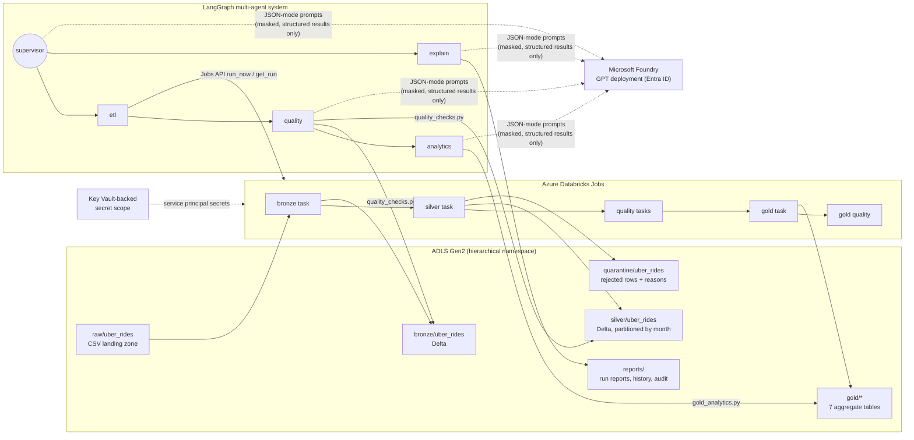

# uber-taxi-agentic-etl

**Agentic ETL pipeline for Uber ride bookings — PySpark · Azure Databricks · ADLS Gen2 · Delta Lake · LangGraph · Microsoft Foundry (GPT)**

[](../../actions/workflows/ci.yml)

Pipelines fail silently: a job can finish *Succeeded* while shipping duplicates, missing days, impossible fares or half the usual volume. This project builds a tested medallion ETL pipeline for 150,000 Delhi-NCR ride bookings and then a **multi-agent AI layer** that runs the pipeline, validates every layer, reasons about failures with GPT on Microsoft Foundry, stops bad data from being published, and writes a plain-language run report.

| | |
|---|---|
| **Phase 1** | Raw CSV → **Bronze** (Delta, raw + metadata) → **Silver** (typed, standardised, de-duplicated, enriched) + **Quarantine** → **Gold** (7 analytics tables), 26 automated data-quality checks |
| **Phase 2** | LangGraph `StateGraph`: **supervisor** routes to **etl**, **quality**, **analytics**, **explain** agents; deterministic hard rules + GPT severity/explanations; guardrails, audit log, reports |
| **Real data result** | 150,000 rows → 148,767 Silver + 1,233 quarantined duplicates · 25/26 checks pass, 1 warning (0.82% duplicate Booking IDs) · ₹46.86M revenue, 62.0% completion |
| **Fault injection** | 10 injected faults + healthy runs — see [docs/evaluation/evaluation_report.md](docs/evaluation/evaluation_report.md) |

---

## Architecture



Agent workflow (exported with `app.get_graph().draw_mermaid_png()`):


Typical paths: **full run** `supervisor → etl → quality → analytics` · **validation only** `supervisor → quality → analytics` · **question** `supervisor → explain`. `etl` ends the run on job failure, `quality` ends it when any hard rule fails.

---

## Repository layout

```
uber-taxi-agentic-etl/
├── data/
│   ├── sample/ncr_ride_bookings_sample.csv   # 500 synthetic rows in the exact source format
│   └── corrupted/*.csv                        # deliberately corrupted variants for testing
├── notebooks/
│   ├── setup.ipynb                            # Spark, ADLS access, folders, schemas, Foundry test
│   └── 01_pipeline_and_agents.ipynb           # walkthrough used for the report screenshots
├── src/
│   ├── config.py           # paths, storage account, thresholds, model settings (env / secret scope)
│   ├── etl_pipeline.py     # Raw → Bronze → Silver + Quarantine (PySpark)
│   ├── gold_analytics.py   # Silver → Gold aggregations (+ OPTIMIZE / ZORDER)
│   ├── quality_checks.py   # reusable rules, structured CheckResult per rule
│   ├── agents.py           # LangGraph supervisor + etl/quality/analytics/explain, tools, Foundry client
│   ├── runners.py          # Databricks Jobs runner, local runner, report store
│   ├── spark_utils.py      # Spark session, Delta read/write helpers
│   ├── run_task.py         # entry point for Databricks Job tasks
│   ├── synthetic_data.py   # source-faithful synthetic data generator
│   └── fault_injection.py  # 10 fault scenarios with expected outcomes
├── scripts/                # run_local_pipeline, run_agents, evaluate_agents, export_graph, ...
├── tests/                  # 71 tests: unit, quality, gold, agents, end-to-end
├── infra/provision_azure.sh
├── databricks.yml          # Databricks Asset Bundle: 3 jobs with retries + failure alerts
├── docs/                   # project report, evaluation, agent graph, sample run report
├── .env.example
└── requirements.txt
```

---

## Quick start (local, no Azure needed)

Requirements: Python 3.10–3.13, Java 17.

```bash
python -m venv .venv && source .venv/bin/activate        # Windows: .venv\Scripts\activate
pip install -r requirements-dev.txt
cp .env.example .env

# 1. Land data: the real Kaggle export (ncr_ride_bookings.csv) or synthetic data
mkdir -p lakehouse/raw/uber_rides && cp /path/to/ncr_ride_bookings.csv lakehouse/raw/uber_rides/
#   or: python scripts/generate_synthetic_data.py --rows 150000

# 2. Phase 1 – run the pipeline and all quality checks
python scripts/run_local_pipeline.py

# 3. Phase 2 – run the agents
python scripts/run_agents.py "Run the full ETL pipeline and validate every layer"
python scripts/run_agents.py "Why did the last run end with warnings?"

# 4. Tests and fault-injection evaluation
pytest
python scripts/evaluate_agents.py --rows 3000
```

> **Windows note.** Spark needs Hadoop's `winutils.exe` to write files on Windows. Either install it (set `HADOOP_HOME`) or set `TABLE_FORMAT=memory` in `.env`; that keeps tables as in-memory DataFrames with the same overwrite / replaceWhere / append semantics. CI (Linux) and Databricks use real Delta tables.

Without `AZURE_OPENAI_ENDPOINT`, the agents use `OfflineLLM`, a deterministic reasoning client with the same interface. Every path still works, and CI needs no secrets.

---

## Deploying to Azure

1. **Provision** (Azure CLI): `bash infra/provision_azure.sh`. This creates the resource group, the ADLS Gen2 account and the containers `raw, bronze, silver, gold, quarantine, reports`. It also creates a Key Vault, a service principal (Storage Blob Data Contributor + Cognitive Services OpenAI User), a Databricks workspace and a Foundry/Azure OpenAI resource with a `gpt-4o` deployment.
2. **Secret scope:** create a Key Vault-backed scope `uber-etl` in Databricks; the script prints the values. It holds `sp-client-id`, `sp-client-secret` and `sp-tenant-id`. Nothing secret lives in code.
3. **Code:** add this repo as a Databricks Git folder and run `notebooks/setup.ipynb` (connectivity, folders, schemas, Foundry test).
4. **Jobs:** deploy them with the Databricks CLI:
   ```bash
   databricks bundle deploy -t dev --var storage_account=<acct> \
     --var foundry_endpoint=https://<aoai>.openai.azure.com/ --var alert_email=<you@example.com>
   databricks bundle run uber_etl_full_pipeline -t dev
   ```
   | Job | Tasks | Purpose |
   |---|---|---|
   | `uber-etl-full-pipeline` | bronze → silver → quality(bronze) → quality(silver) → gold → quality(gold) | scheduled/on-demand pipeline; retries on compute tasks, none on quality tasks, email on failure |
   | `uber-etl-bronze-silver` | bronze → silver | the job the `etl` agent triggers and polls |
   | `uber-agentic-supervisor` | agents | runs the LangGraph workflow with Foundry GPT (`EXECUTION_BACKEND=databricks`) |
5. **Agents from your laptop against Databricks:** set `EXECUTION_BACKEND=databricks`, `DATABRICKS_HOST`, `DATABRICKS_BRONZE_SILVER_JOB_ID`, `STORAGE_MODE=adls` and the Foundry variables, then run `python scripts/run_agents.py`.

---

## Phase 1 — pipeline

**Bronze** (`ingest_bronze`):
- Validates every source header against the 21-column contract and fails fast with `SourceSchemaError`; an empty landing zone raises `MissingSourceError`.
- Reads with an explicit all-string schema, treating the literal text `null` as a real null.
- Strips the quotes around Booking/Customer IDs and adds `ingestion_timestamp`, `source_file`, `batch_id`, `booking_date` and `booking_month`.
- Idempotent: a full load overwrites; an incremental load (`--from-date/--to-date`) replaces exactly that booking-date window with Delta `replaceWhere`.

**Silver** (`build_silver`):
- Combines `Date` (dd-MM-yyyy, or the Kaggle export's yyyy-MM-dd) and `Time` into `booking_timestamp`.
- Uses safe casts (`try_cast`), so text in numeric columns is rejected instead of silently becoming null.
- Canonicalises status, vehicle type and payment method.
- Derives `booking_date, booking_hour, day_of_week, is_cancelled, cancelled_by, cancellation_reason`.
- Applies 15 row rules shared with `quality_checks.py`. Failing rows, and every copy of a Booking ID except one, go to **quarantine** with their raw values and `reject_reasons`.

**Gold** (`build_gold_tables`): `daily_bookings`, `cancellations_by_reason` (customer vs driver), `revenue_by_vehicle_payment`, `peak_hour_demand`, `top_locations`, `vehicle_performance` (avg VTAT/CTAT, ratings), `incomplete_rides_by_reason`. They are fully rebuilt each run and optimised with `OPTIMIZE … ZORDER BY` on Databricks.

**Quality framework:** each check returns `rule, layer, category, status (PASS/WARN/FAIL), metric_value, threshold, hard, sample_failures`. Thresholds live in `config.py` (overridable via env).

| Category | Checks |
|---|---|
| Completeness | key columns non-null (Bronze rate; Silver = 0) |
| Outcome completeness | Completed rides have value + distance (hard); payment method (soft warning) |
| Uniqueness | duplicate Booking IDs (Bronze rate; Silver = 0) |
| Validity | ratings 1–5, non-negative value/distance/VTAT/CTAT, numeric parse, allowed status/vehicle/payment |
| Consistency | cancellation/incomplete flags ⇔ status; reason present ⇔ flag set |
| Timeliness | no missing calendar days in the expected range |
| Volume | row count vs previous load (±10% warn, ±20% fail); quarantine rate |
| Reconciliation | Bronze = Silver + Quarantine; Gold daily totals and revenue = Silver |

## Phase 2 — agents

| Agent | Role | Tools (allowlisted) |
|---|---|---|
| `supervisor` | GPT classifies the request (JSON) → `run_etl / quality / analytics / explain`, extracts date window, flags destructive intent | `read_run_history` |
| `etl` | triggers the Bronze→Silver job, polls with timeout, retries transient failures only, GPT diagnoses failures | `run_etl_job`, `get_run_status`, `cancel_run`, `compare_row_counts`, `write_report` |
| `quality` | runs Bronze + Silver checks, GPT classifies severity and explains causes; any critical → stop | `run_quality_checks`, `get_table_stats`, `compare_row_counts` |
| `analytics` | builds Gold, validates reconciliation / dates / plausibility vs history, final verdict | `build_gold_tables`, `run_quality_checks`, `gold_kpis` |
| `explain` | answers questions from run history and reports; read-only on data | `read_run_history`, `read_report`, `get_table_stats`, `write_report` |

**LLM-assisted validation:** only structured check results are sent to GPT, never raw data, and Booking/Customer IDs are masked. The model returns `{severity, explanation, recommended_action}` per finding. **Hard-rule failures are locked to `critical`**: the model can explain them but never downgrade them, and it can only escalate soft rules.

**Guardrails:**
- Per-agent tool allowlists.
- Writes are restricted to `reports/`; path traversal is rejected.
- Human approval is required for destructive requests and for backfills longer than `BACKFILL_LIMIT_DAYS`.
- Every tool call is logged (agent, tool, masked args, status, duration).
- Token budget per call and per run, plus LLM and job retry limits and a job timeout.
- The run falls back to deterministic reasoning if Foundry is unavailable.

**Outputs:** `reports/runs/<run_id>/report.json` (the format from the brief), `report.md`, `state.json` (full state + tool-call audit) and `reports/run_history.jsonl`. Example: [docs/sample_run/report.md](docs/sample_run/report.md).

```json
{
  "run_id": "2026-10-14T20-04-38-8af0",
  "route": "run_etl",
  "nodes_run": ["supervisor", "etl", "quality", "analytics"],
  "status": "PASS_WITH_WARNINGS",
  "row_counts": {"bronze": 150000, "silver": 148767, "quarantine": 1233},
  "checks_passed": 25, "checks_warned": 1, "checks_failed": 0,
  "findings": [{"rule": "bronze_unique_booking_id", "severity": "warning",
                "explanation": "Share of Booking IDs that appear more than once: observed 0.82% vs threshold warn > 0.50%, fail > 2.00% (1233 of 150000 records).",
                "recommended_action": "Check whether the same file was delivered twice or overlapping extracts were landed; de-duplicate at source and re-ingest."}],
  "escalated_to_human": false
}
```

---

## Documentation

- [docs/PROJECT_REPORT.md](docs/PROJECT_REPORT.md): the full project report (sections 1–10 of the brief)
- [docs/evaluation/evaluation_report.md](docs/evaluation/evaluation_report.md): fault-injection results and metrics
- [docs/sample_run/report.md](docs/sample_run/report.md): agent run report on the real 150k dataset
