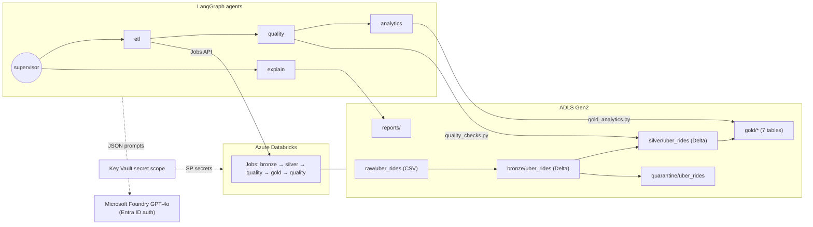
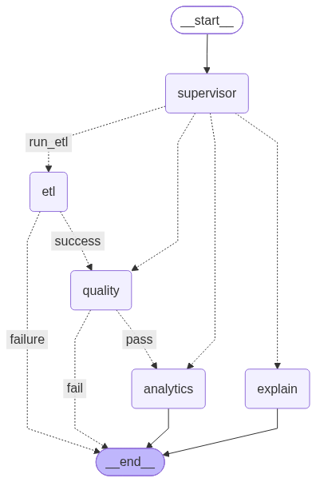

# Capstone Project 3 — Agentic ETL Pipeline with PySpark, Databricks, ADLS and Microsoft Foundry

**Project:** `uber-taxi-agentic-etl` · **Author:** Nandini Arjun · **Date:** October 2026

> Screenshot placeholders are marked **📷**. Capture them from your Azure subscription after deployment (see Section 6 and the README "Deploying to Azure" steps) and paste them in place.

---

## 1. Problem statement and objectives

Data pipelines fail silently: a Databricks job can finish with status *Succeeded* while delivering duplicate rows, missing days, impossible fares or a shrunken record count. Engineers then spend hours on manual checks, reading logs and re-running jobs.

The project delivers, in two phases:

1. **A production-style ETL pipeline:** Uber Delhi-NCR ride bookings (completed, incomplete, cancelled and unfulfilled) are ingested into ADLS Gen2 and transformed with PySpark on Databricks through Bronze, Silver and Gold Delta layers. Automated data-quality and business-rule checks verify every layer.
2. **A multi-agent AI layer** (LangGraph + GPT on Microsoft Foundry) that triggers and monitors the Databricks jobs and validates each layer with deterministic rules. It uses GPT to classify severity, explain failures and recommend fixes, stops the run when validation fails, and writes a human-readable run report.

**Objectives met**

| Objective | Where |
|---|---|
| Modular PySpark ETL on Databricks | `src/etl_pipeline.py`, `src/gold_analytics.py`, `databricks.yml` |
| Layered ADLS Gen2 layout | `src/config.py`, `infra/provision_azure.sh` |
| Data-quality and business-rule validation | `src/quality_checks.py` (26 dataset checks, 15 row rules) |
| Agents that trigger jobs, interpret results and decide | `src/agents.py`, `src/runners.py` |
| Foundry GPT for reasoning, summaries, remediation | `FoundryLLM` in `src/agents.py` |
| Fault injection and evaluation | `src/fault_injection.py`, `scripts/evaluate_agents.py` |

## 2. Architecture



- **Storage:** an ADLS Gen2 account with hierarchical namespace and one container per layer. Databricks reaches it with OAuth through a service principal whose ID, secret and tenant live in a Key Vault-backed secret scope (`{{secrets/uber-etl/...}}` in the cluster `spark_conf`). A Unity Catalog external location is the documented alternative.
- **Compute:** Databricks Jobs defined as code in a Databricks Asset Bundle (`databricks.yml`).
- **AI:** a GPT-4o deployment on Microsoft Foundry, called through one `AzureOpenAI` client with Entra ID (`DefaultAzureCredential`). An API-key mode via the secret scope is also supported.
- **Agents:** a LangGraph `StateGraph` with a supervisor and four worker nodes. State is persisted with a checkpointer and written to `reports/runs/<run_id>/state.json`.

📷 *Azure resource group overview (storage account, Databricks workspace, Key Vault, Foundry resource).*

## 3. Dataset and ADLS layout

**Dataset:** `ncr_ride_bookings.csv`, 150,000 bookings with 21 columns, covering 2024-01-01 to 2024-12-30 (365 days, none missing).

Profiling results (confirmed during development):

| Attribute | Values |
|---|---|
| Booking Status | Completed 93,000 (62%) · Cancelled by Driver 27,000 · No Driver Found 10,500 · Cancelled by Customer 10,500 · Incomplete 9,000 |
| Vehicle Type | Auto, Go Mini, Go Sedan, Bike, Premier Sedan, eBike, Uber XL |
| Payment Method | UPI, Cash, Uber Wallet, Credit Card, Debit Card (null for non-completed outcomes) |
| Date format | `yyyy-MM-dd` in the Kaggle export (spec states `dd-MM-yyyy`; both are parsed) |
| IDs | wrapped in literal quotes (`"""CNR5884300"""` in the CSV) |
| Missing values | literal text `null` |
| Duplicate Booking IDs | **1,233 (0.82%)**, with distinct content (not exact duplicate rows) |
| Ranges | VTAT 2–20 min · CTAT 10–45 min · value ₹50–4,277 · distance 1–50 km · ratings 3.0–5.0 |

Outcome-dependent nulls (share of non-null values per status):

| Column | Completed | Incomplete | Cancelled by Driver | Cancelled by Customer | No Driver Found |
|---|---|---|---|---|---|
| Avg VTAT | ✔ | ✔ | ✔ | ✔ | – |
| Avg CTAT, Booking Value, Ride Distance, Payment Method | ✔ | ✔ | – | – | – |
| Driver / Customer Rating | ✔ | – | – | – | – |
| Cancellation / incomplete flag + reason | – | incomplete | driver | customer | – |

**VTAT/CTAT definitions (from profiling):** VTAT is the vehicle's average time to arrive at the pickup. It is present whenever a driver was assigned and absent for *No Driver Found*. CTAT is the customer trip turnaround time, present only when the trip started (Completed or Incomplete).

**ADLS layout**

| Container / path | Content | Format / partitioning |
|---|---|---|
| `raw/uber_rides/` | source CSV files as received | CSV |
| `bronze/uber_rides/` | all 21 columns as strings + `ingestion_timestamp, source_file, batch_id, booking_date, booking_month` | Delta, partitioned by `booking_month` |
| `silver/uber_rides/` | typed, standardised, deduplicated, enriched | Delta, partitioned by `booking_month` |
| `quarantine/uber_rides/` | rejected rows with raw values, `reject_reasons[]`, `primary_reject_reason` | Delta |
| `gold/<table>/` | 7 aggregate tables | Delta, OPTIMIZE + ZORDER |
| `reports/` | `runs/<run_id>/report.{json,md}`, `state.json`, `run_history.jsonl`, `_pipeline_audit` | JSON / Markdown / Delta |

📷 *Storage account → Containers list.* 📷 *ADLS folder tree for each layer (Storage browser).*

## 4. Data transformation logic

### Bronze (`etl_pipeline.ingest_bronze`)
1. List the CSV files in the landing zone. If there are none, raise `MissingSourceError`.
2. Validate each file header against the 21-column contract; on drift, raise `SourceSchemaError` before anything is written.
3. Read with an explicit all-string schema, using `nullValue="null"` and `escape='"'`, and capture `_metadata.file_path`.
4. Rename to snake_case, strip the quotes around IDs, and normalise blanks and the `null`/`None` texts to null.
5. Add `ingestion_timestamp`, `source_file` and `batch_id` (the Databricks `job.run_id`), plus the parsed `booking_date` and `booking_month` for partitioning.
6. **Idempotent write:** a full load overwrites. An incremental load (`from_date`/`to_date`) replaces only that window with Delta `replaceWhere`, so re-running the same window never duplicates data.
7. Append a row to the `_pipeline_audit` table (row counts per stage), which drives the volume checks.

### Silver (`etl_pipeline.build_silver`)
- `booking_timestamp = try_to_timestamp(Date || ' ' || Time)` over several accepted formats, stored as `TIMESTAMP_NTZ` (local Delhi wall-clock time).
- Numeric columns use `try_cast`; a non-null raw value that fails to cast sets `invalid_numeric_value`.
- Canonical domains: case-, punctuation- and alias-insensitive mapping (`e-bike → eBike`, `canceled by customer → Cancelled by Customer`, `wallet → Uber Wallet`).
- Derived columns: `booking_date, booking_month, booking_hour, day_of_week, is_completed, is_cancelled, cancelled_by (customer/driver), cancellation_reason` (the unified reason).
- **Row rules** (shared with the quality module): `missing_required_key`, `invalid_numeric_value`, `invalid_booking_status`, `invalid_vehicle_type`, `invalid_payment_method`, `negative_booking_value`, `negative_ride_distance`, `negative_turnaround_time`, `driver_rating_out_of_range`, `customer_rating_out_of_range`, `completed_missing_value_or_distance`, `customer_cancel_flag_mismatch`, `driver_cancel_flag_mismatch`, `incomplete_flag_mismatch`, `reason_flag_mismatch`.
- **Deduplication:** a window over `booking_id` keeps the best row, preferring valid rows and then the latest ingested. The remaining copies get `duplicate_booking_id`.
- Rows with any reject reason are written to **quarantine** with their *raw* string values. Valid rows are written to Silver.

### Gold (`gold_analytics.build_gold_tables`)

| Table | Grain | Key measures |
|---|---|---|
| `daily_bookings` | booking_date | total, completed, per-outcome counts, completion & cancellation rate, revenue, unique customers |
| `cancellations_by_reason` | cancelled_by × reason | cancellations, share within party |
| `revenue_by_vehicle_payment` | vehicle × payment | completed rides, revenue, avg value, avg distance, revenue/km |
| `peak_hour_demand` | day_of_week × hour | bookings, completed, no-driver-found, completion rate, demand rank |
| `top_locations` | pickup/drop × location (top 20) | bookings, completion rate, revenue |
| `vehicle_performance` | vehicle_type | completion rate, avg VTAT/CTAT, avg driver & customer rating, avg distance, revenue |
| `incomplete_rides_by_reason` | reason × vehicle | incomplete rides, share |

On Databricks (`OPTIMIZE_GOLD=true`) each table gets `OPTIMIZE … ZORDER BY` on its main filter column, and Silver/Bronze use optimised writes.

📷 *Delta table previews: Bronze, Silver, Quarantine (grouped by reason), and two Gold tables.*

## 5. Data quality framework

Every check returns a structured `CheckResult`: `rule, layer, category, status (PASS | WARN | FAIL), metric_value, threshold {warn, fail}, hard, failing_count, total_count, sample_failures[≤5], details`. Rate-based checks grade as **PASS** when the rate is ≤ warn, **WARN** when it is ≤ fail, and **FAIL** above that. A FAIL on a **hard** rule stops the pipeline: the Databricks quality task raises `DataQualityError` and the agents end the run.

| # | Rule | Layer | Category | Warn / Fail | Hard |
|---|---|---|---|---|---|
| 1 | `bronze_schema` | Bronze | validity | any missing column | ✔ |
| 2 | `bronze_not_empty` | Bronze | volume | 0 rows | ✔ |
| 3 | `bronze_key_completeness` | Bronze | completeness | 0.5% / 2% | ✔ |
| 4 | `bronze_value_ranges` | Bronze | validity | 0.1% / 1% | ✔ |
| 5 | `bronze_allowed_domains` | Bronze | validity | 0.1% / 1% | ✔ |
| 6 | `bronze_status_flag_consistency` | Bronze | consistency | 0.1% / 1% | ✔ |
| 7 | `bronze_reason_flag_pairing` | Bronze | consistency | 0.1% / 1% | ✔ |
| 8 | `bronze_completed_outcome_completeness` | Bronze | outcome completeness | 0.1% / 1% | ✔ |
| 9 | `bronze_unique_booking_id` | Bronze | uniqueness | 0.5% / 2% | ✔ |
| 10 | `bronze_timeliness` | Bronze | timeliness | 0% / 1% days missing | ✔ |
| 11 | `bronze_volume_vs_previous_load` | Bronze | volume | ±10% / ±20% | ✔ |
| 12–16 | `silver_not_empty`, `silver_completeness`, `silver_validity`, `silver_consistency`, `silver_outcome_completeness` | Silver | various | 0 / 0 (strict) | ✔ |
| 17 | `silver_unique_booking_id` | Silver | uniqueness | 0 / 0 | ✔ |
| 18 | `completed_rides_missing_payment_method` | Silver | outcome completeness | 0.1% / 5% | ✘ (soft) |
| 19 | `bronze_to_silver_reconciliation` | Silver | reconciliation | difference ≠ 0 | ✔ |
| 20 | `silver_quarantine_rate` | Silver | validity | 2% / 5% | ✔ |
| 21 | `gold_tables_present` | Gold | completeness | any missing | ✔ |
| 22 | `gold_daily_totals_reconcile` | Gold | reconciliation | ≠ Silver count | ✔ |
| 23 | `gold_revenue_reconcile` | Gold | reconciliation | > ₹0.01 | ✔ |
| 24 | `gold_no_missing_dates` | Gold | timeliness | 0% / 1% | ✔ |
| 25 | `gold_completion_rate_plausible` | Gold | validity | outside 30–95% or drift > 15 pts vs history | ✘ |
| 26 | `gold_averages_plausible` | Gold | validity | ratings ∉ [1,5] or negative VTAT/CTAT | ✔ |

**Testing:** 71 automated tests (`pytest`):
- unit tests for parsing, quote/null handling, canonicalisation, derived columns, and every quarantine reason (13 parametrised cases);
- deduplication and quarantine raw-value preservation;
- Gold reconciliation tests;
- quality checks passing on clean data and failing on each corrupted variant;
- 24 agent-workflow tests;
- 6 end-to-end tests: full pipeline, idempotent re-run, incremental window, and the agents on real Spark.

CI (GitHub Actions, Ubuntu + Java 17) runs the full suite on real Delta tables, then the fault-injection evaluation.

**Result on the full real dataset (150,000 rows):**

```
bronze  150,000 rows → silver 148,767 + quarantine 1,233 (all duplicate_booking_id)  → reconciled
checks: 26 total · 25 PASS · 1 WARN (bronze_unique_booking_id = 0.82%) · 0 FAIL
gold:   365 days · 92,244 completed · completion rate 62.01% · revenue ₹46,859,058
```

📷 *Quality check results table (notebook 01).*

## 6. Databricks Job configuration and test results

Defined in `databricks.yml` (deploy with `databricks bundle deploy`):

| Job | Tasks / dependencies | Reliability settings |
|---|---|---|
| `uber-etl-full-pipeline` | `bronze → silver → quality_bronze_silver → quality_silver → gold → quality_gold` | job cluster DBR 15.4 LTS, 2 workers; `max_retries: 2` + 60 s back-off on bronze/silver/gold; `max_retries: 0` on quality tasks; 2 h job timeout; `max_concurrent_runs: 1`; email `on_failure`; daily 06:00 IST schedule (paused); `from_date`/`to_date` job parameters |
| `uber-etl-bronze-silver` | `bronze → silver` | triggered by the `etl` agent through the Jobs API |
| `uber-agentic-supervisor` | `agents` | runs `scripts/run_agents.py` with `EXECUTION_BACKEND=databricks`, Foundry via Entra ID, scheduled 06:30 IST (paused) |

Each task runs `src/run_task.py --task <bronze|silver|gold|quality>` and prints its metrics as the final JSON line. The agents read that line back through `jobs.get_run_output().logs`. Quality tasks raise on any FAIL, so a bad load fails the job run and triggers the alert.

📷 *Databricks cluster configuration.* 📷 *Job DAG.* 📷 *Job run history (successful run + a failed run from a fault).* 📷 *Notebook run of `setup.ipynb`.*

## 7. Agent design

### Workflow



| Edge | Condition |
|---|---|
| `supervisor → etl / quality / analytics / explain` | route chosen by GPT (JSON); a deterministic keyword router validates/falls back |
| `etl → quality` | job `result_state == SUCCESS` |
| `etl → __end__` | job failed after retries / timed out / approval refused |
| `quality → analytics` | no finding with severity `critical` |
| `quality → __end__` | any critical finding |
| `analytics → __end__`, `explain → __end__` | always |

### Roles and tools

| Agent | Responsibilities | Tools |
|---|---|---|
| supervisor | classifies the request, extracts the date window, detects destructive intent, owns `run_id` and shared state | `read_run_history` |
| etl | checks the backfill limit, `run_etl_job` → polls `get_run_status` every N seconds up to the timeout (then `cancel_run`), retries only transient errors (`job_max_retries`), asks GPT to diagnose failures | `run_etl_job`, `get_run_status`, `cancel_run`, `compare_row_counts`, `write_report` |
| quality | runs the Bronze + Silver checks, sends non-passing results to GPT for severity/explanation/action, merges with deterministic rules, decides pass/fail | `run_quality_checks`, `get_table_stats`, `compare_row_counts`, `read_run_history` |
| analytics | builds Gold, runs the Gold checks (completion rate vs history), gets KPIs, gives the final verdict | `build_gold_tables`, `run_quality_checks`, `gold_kpis`, `get_table_stats` |
| explain | answers questions from the run history, the latest report and table stats; read-only on pipeline data; writes Q&A reports | `read_run_history`, `read_report`, `get_table_stats`, `write_report` |

The tools are LangChain `StructuredTool`s with Pydantic input schemas (e.g. `layer: Literal["bronze","silver","gold"]`). Every invocation goes through `PipelineToolkit.call`, which enforces the agent's allowlist and records an audit entry: timestamp, agent, tool, masked args, status and duration.

### Decision logic: rules plus model
- Each node runs the deterministic checks first.
- Only **structured results** (rule, metric, threshold, counts, ≤ 3 masked samples) go to GPT, never raw rows.
- GPT returns `{rule, severity, explanation, recommended_action}`.
- `_merge_findings` locks hard-rule FAILs to `critical`, so the model cannot override them. A soft-rule FAIL is at least `warning`, and the model may *escalate* warnings.
- Final status: any critical → `FAIL`; else any warning → `PASS_WITH_WARNINGS`; else `PASS`. `escalated_to_human` is true for FAIL or for a refused approval.

### Guardrails and safety

| Control | Implementation |
|---|---|
| Approved tools only | `AGENT_TOOL_ALLOWLIST`; denied calls raise `ToolNotAllowedError` and are logged |
| Approved paths only | `ReportStore.safe_path` rejects absolute paths, drive letters and `..`; agents can only write in `reports/` |
| Human approval | destructive requests (delete/drop/truncate/purge/vacuum) and backfills > `BACKFILL_LIMIT_DAYS` (31) call `approval_callback`; refusal → `ESCALATED`, nothing runs |
| Sensitive data | `mask_sensitive` → `CNR***300`, `CID***`, `customer_id` removed before any prompt or log |
| Audit | every tool call in `state.json` and the process log |
| Cost control | `max_tokens` per call (800), per-run token budget (12,000), LLM retries (2, exponential back-off), job retries (1), job timeout |
| Resilience | any LLM error, invalid JSON or exhausted budget → deterministic `OfflineLLM` fallback (counted in `usage.fallbacks`) |
| Read-only explain | the explain agent has no write tools except `write_report` |

## 8. Foundry GPT deployment and prompt design

- **Deployment:** an Azure OpenAI resource in Microsoft Foundry (`kind=OpenAI`, S0) with a `gpt-4o` deployment, version 2024-11-20, GlobalStandard SKU. The script is `infra/provision_azure.sh`.
- **Authentication:** Microsoft Entra ID through `DefaultAzureCredential` and `get_bearer_token_provider(..., "https://cognitiveservices.azure.com/.default")`. The service principal holds the *Cognitive Services OpenAI User* role. API-key auth is available with `FOUNDRY_AUTH=key` (key read from the secret scope).
- **Client:** a single `FoundryLLM` in `agents.py`, configured from `config.py`. It uses `response_format={"type":"json_object"}` and `temperature=0`, and records token usage and latency.
- **Prompts** (`SYSTEM_*` constants in `agents.py`) share four principles: give the model a role, include domain context, require a strict JSON schema, and forbid inventing numbers:

| Prompt | Output schema | Notes |
|---|---|---|
| `SYSTEM_SUPERVISOR` | `{route, from_date, to_date, destructive, reason}` | route definitions with examples of each intent |
| `SYSTEM_CLASSIFY` | `{findings:[{rule, severity, explanation, recommended_action}]}` | states that `hard_rule_failed=true` must stay critical; explanations must quote metric and threshold |
| `SYSTEM_JOB_FAILURE` | `{explanation, recommended_action, retry_may_help}` | uses only error type, message and trace tail |
| `SYSTEM_SUMMARY` | `{summary}` | 3–5 sentence executive summary |
| `SYSTEM_ANSWER` | `{answer}` | answers only from the provided run history / reports / stats |

The notebook `setup.ipynb` (section 6) runs a test prompt against the endpoint.

📷 *Foundry portal: model deployment page (name, version, endpoint).* 📷 *Setup notebook: Foundry test call output.*

## 9. Fault-injection results and evaluation

Each scenario runs on a fresh lakehouse (3,000 rows per scenario):
1. land clean data and run a baseline load, which gives the volume check a previous load;
2. inject the fault into the landing zone;
3. run the full agent workflow.

Healthy scenarios use the same steps without the fault and measure false alarms.

**Results** (full output: [evaluation/evaluation_report.md](evaluation/evaluation_report.md), raw JSON: [evaluation/evaluation_results.json](evaluation/evaluation_results.json))

| Metric | Result |
|---|---|
| Detection rate | **100%** (10/10 injected faults detected) |
| False-alarm rate | **0%** (0/3 healthy runs flagged) |
| Recovery rate | **100%** (stopped at the expected node, expected rule explained, action recommended) |
| Status accuracy | 100% (13/13 scenarios) |
| Median agent run time | 11.9 s per run on 3,000 rows (local Spark); 81 s for the full 150k-row run |
| Time saved | ≈ 44.8 min per run vs a 45-min manual validation baseline |
| Tokens / cost | 0 in this evaluation (deterministic offline client, so CI needs no secrets). With Foundry GPT-4o, expect 2–4 calls and roughly 2–5k tokens per run, capped at 12k |

| Scenario | Expected | Actual | Stop node (expected) | Rules flagged | Explained | Recovered | Agent s |
|---|---|---|---|---|---|---|---|
| healthy_1 | PASS | PASS | analytics (analytics) | - | yes | - | 24.06 |
| healthy_2 | PASS | PASS | analytics (analytics) | - | yes | - | 22.21 |
| healthy_3 | PASS | PASS | analytics (analytics) | - | yes | - | 19.58 |
| missing_source_file | FAIL | FAIL | etl (etl) | MissingSourceError | yes | yes | 0.24 |
| schema_change | FAIL | FAIL | etl (etl) | SourceSchemaError | yes | yes | 0.24 |
| job_failure | FAIL | FAIL | etl (etl) | job_failure | yes | yes | 0.24 |
| duplicate_records | FAIL | FAIL | quality (quality) | bronze_unique_booking_id, silver_quarantine_rate | yes | yes | 11.57 |
| null_spike | FAIL | FAIL | quality (quality) | bronze_key_completeness, silver_quarantine_rate | yes | yes | 12.28 |
| out_of_range_values | FAIL | FAIL | quality (quality) | bronze_value_ranges, silver_quarantine_rate | yes | yes | 11.94 |
| status_flag_mismatch | FAIL | FAIL | quality (quality) | bronze_status_flag_consistency, silver_quarantine_rate | yes | yes | 11.9 |
| row_count_drop | FAIL | FAIL | quality (quality) | bronze_volume_vs_previous_load, bronze_timeliness | yes | yes | 11.1 |
| missing_dates | FAIL | FAIL | quality (quality) | bronze_timeliness | yes | yes | 12.95 |
| payment_method_gap | PASS_WITH_WARNINGS | PASS_WITH_WARNINGS | analytics (analytics) | completed_rides_missing_payment_method | yes | yes | 18.34 |

Observations:
- **Failures before any data is written** stop at `etl` in under 0.3 s: missing file, schema drift, and the crashed job (retried once, then stopped).
- **Data faults** are caught by the specific Bronze rule. The quarantine-rate rule fires as corroborating evidence, which the explanation reports alongside the root rule.
- **Row-count drop** also trips timeliness, since a 55% sample leaves some days empty. Both findings are reported.
- **The soft payment-method gap** does not stop the run. It ends `PASS_WITH_WARNINGS` with the recommended action, the same behaviour as the example in the brief.


**Metric definitions**
- **Detection rate:** share of faulty runs whose final status was not `PASS`.
- **False-alarm rate:** share of healthy runs not ending in `PASS`.
- **Recovery rate:** share of faulty runs that stopped at the expected node, with the expected status, and with a finding naming the expected rule plus an explanation and a recommended action.
- **Time saved:** the 45-minute manual validation baseline (row counts, null/dup/range queries, log reading, report write-up) minus the median agent run time.
- **Report quality:** reviewed manually. Explanations quote the metric, threshold and affected counts, and each recommended action is specific to the rule (see [sample report](sample_run/report.md)).
- **Cost and latency:** tokens per run come from Foundry `usage`. Offline evaluation reports 0 tokens; with GPT-4o a full run makes 2–4 calls of about 600–1,500 tokens each, under the 12,000-token budget.

📷 *Agent run logs (tool-call audit table).* 📷 *Generated run report (`reports/runs/<id>/report.md`).*

## 10. Challenges, limitations and future work

**Challenges**
- *Outcome-dependent nulls.* A null is only an error for some statuses. Rules are therefore status-aware (e.g. value/distance are mandatory only for Completed bookings), and flag/reason pairing is checked in both directions.
- *Real duplicates.* The source has 1,233 duplicate Booking IDs with different content. They are quarantined deterministically (valid row first, then latest ingested) and surfaced as a warning rather than a failure, because the rate is within the agreed tolerance.
- *Date format drift.* The spec says `dd-MM-yyyy`, but the export uses `yyyy-MM-dd`. Parsing tries several formats with `try_to_timestamp`, so a bad date is quarantined instead of crashing an ANSI-mode job.
- *Silent nulls from casting.* `try_cast` plus an explicit parse-error flag stops text in numeric columns from turning into nulls unnoticed.
- *Local development on Windows.* Spark needs `winutils.exe` to write files on Windows, so an in-memory table backend (`TABLE_FORMAT=memory`) with the same overwrite/`replaceWhere`/append semantics keeps the whole pipeline runnable locally. CI and Databricks use Delta.

**Limitations**
- *Model errors.* GPT can mis-explain a cause. It cannot change a hard-rule decision, but a wrong explanation could still mislead a human. Mitigations: explanations must quote the provided metrics, temperature is 0, and there is a deterministic fallback.
- *Cost.* Every non-passing check triggers an LLM call. Batching all findings into one call per node keeps a run to 2–4 calls.
- *Security.* The service principal holds broad Storage Blob Data Contributor rights on the account. Production should use per-container RBAC/ACLs, Unity Catalog grants, managed identity instead of client secrets, and private endpoints.
- Thresholds are static and hand-tuned.
- The volume check compares only with the previous load and ignores seasonality.

**Future work**
- Learn thresholds from history (rolling mean ± kσ, seasonality per weekday).
- Add a monitoring agent for duration/DBU-cost drift and connect alerts to Teams or PagerDuty.
- Use Unity Catalog lineage and Delta Live Tables expectations as an extra enforcement layer.
- Replace `MemorySaver` with a durable checkpointer (Postgres or Cosmos DB) to support human-in-the-loop interrupts and resume.
- Evaluate explanation quality with an LLM-as-judge rubric alongside manual review.

---

### Appendix A — How to reproduce

```bash
pip install -r requirements-dev.txt
cp ncr_ride_bookings.csv lakehouse/raw/uber_rides/
python scripts/run_local_pipeline.py          # Phase 1
python scripts/run_agents.py                  # Phase 2
pytest                                        # 71 tests
python scripts/evaluate_agents.py --rows 3000 # Section 9
```

### Appendix B — Screenshot checklist

| # | Screenshot | Source |
|---|---|---|
| 1 | Azure storage account and containers | Portal → Storage account → Containers |
| 2 | ADLS folder layers | Storage browser → each container → `uber_rides/` |
| 3 | Databricks cluster | Compute → job cluster config |
| 4 | Notebook runs | `notebooks/setup.ipynb`, `01_pipeline_and_agents.ipynb` |
| 5 | Delta table previews per layer | notebook 01, cells "Bronze/Silver/Quarantine/Gold" |
| 6 | Quality check results | notebook 01, "Data quality checks" |
| 7 | Databricks Job run history | Workflows → `uber-etl-full-pipeline` → Runs |
| 8 | Foundry model deployment | Foundry portal → Deployments |
| 9 | Agent run logs | `reports/runs/<id>/state.json` / notebook output |
| 10 | Generated run report | `reports/runs/<id>/report.md` |
